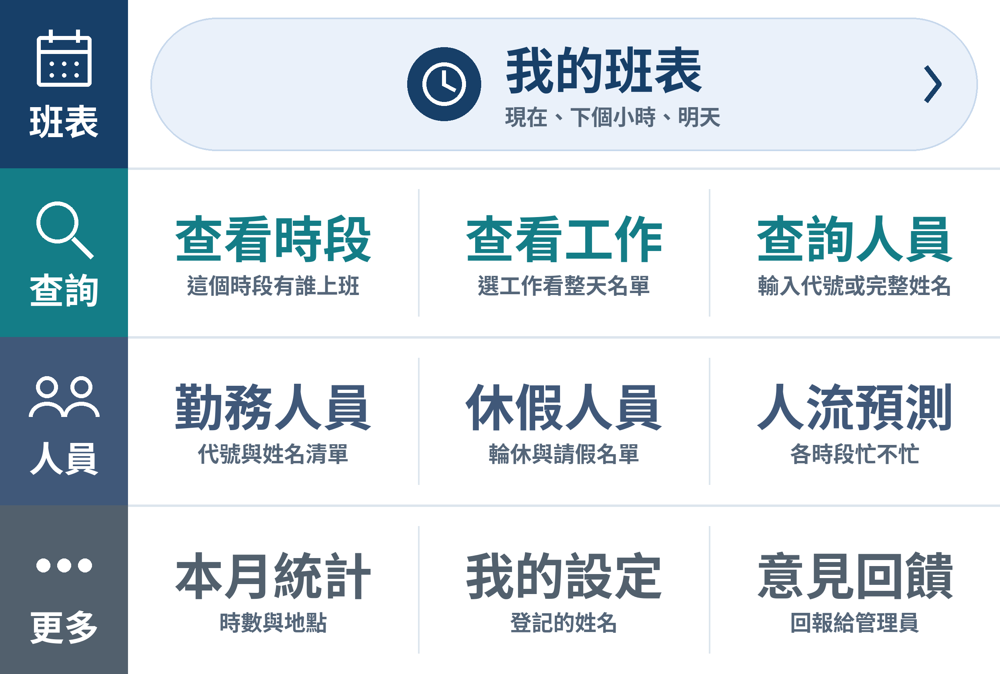

# Duty Roster LINE Bot

A LINE bot that reads a security team's daily roster photo and turns it into a personal schedule for everyone on the team. I built it during my military service (Sep–Oct 2026); **82 teammates use it**, and it reads rosters at **98% accuracy**.

## Why

The team works from one printed roster with codes for every person and hour. Finding your own shifts took 5–10 minutes each time, and people sometimes went to the wrong post. Now someone posts the roster photo in the LINE group, and everyone gets their own schedule by asking the bot. The team's feedback: "super convenient, and nobody goes to the wrong shift anymore."

## What it does

- **Group chat:** reads each roster photo quietly when it is posted.
- **Private chat:** "my roster" (now, next hour, tomorrow); who is on a time slot, a job or a person; who is on duty or on leave; a busy-hours forecast; monthly hours with an overtime-pay estimate.
- **Officers and admins:** manage the staff list and fixed codes, and review recognition reports.

## How it works

1. **Perspective correction and grid detection** with OpenCV, then the roster is cut into one image per cell.
2. **ResNet-18 multi-label cell classifier** (PyTorch) reads each cell. It replaced a per-image GPT vision-API call, which removed the API cost.
3. **Tesseract OCR** reads the day's name–code table, so codes map to names.
4. **Labeling and training:** a labeling tool with model pre-annotation (human in the loop); train / validation / test are split by source roster to prevent leakage.
5. **Serving:** FastAPI + SQLite in Docker Compose, exposed to LINE through Cloudflare Tunnel.

## Stack

Python · PyTorch · OpenCV · Tesseract · FastAPI · SQLite · LINE Messaging API · Docker Compose · Cloudflare Tunnel · React (local tools)

## Repository layout

| Path | What is in it |
| --- | --- |
| `all_staff/` | Current bot: grid and cell segmentation, recognizer training and inference, name table OCR, LINE webhook, rich menu, monthly stats, labeling and monitoring pages |
| `schedule_reader.py`, `line_bot.py` | First version, which read the roster with a GPT vision model |
| `frontend/` | React tool for reading one roster image locally |
| `test_*.py` | Tests for the reader, grid, bot flows and stats |
| `docs/README_zh.md` | Full setup and operations guide (Chinese) |

## Data and privacy

This public copy has **no real roster photos, staff names, LINE user IDs or trained weights**. Every name in the tests and examples is fictional, and the hostnames are placeholders. To run it you need your own roster images and staff list; see `configs/*.example.*` and `.env.example`.
